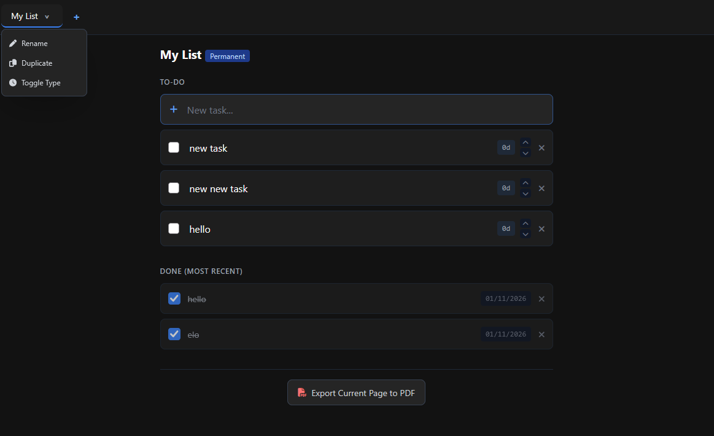
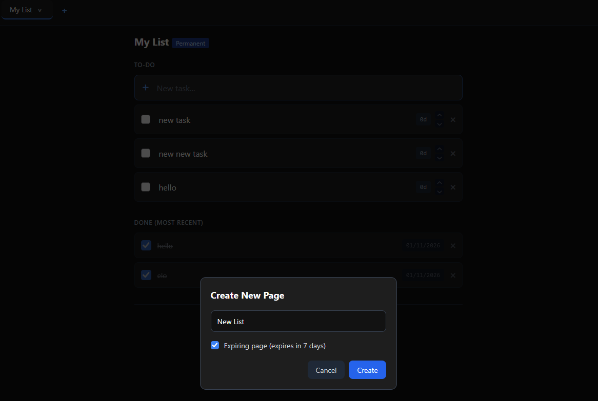
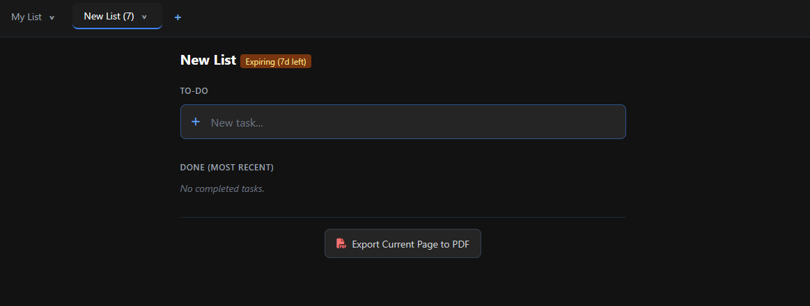

# 📝 VibeNotes

**VibeNotes** is a **vibe-coded** (i was bored), sleek, mobile-optimized, dark-mode To-Do list web application built with **Python (Flask)**. Inspired by OneNote and Google Keep, it allows you to organize tasks across custom pages, handle temporary/expiring shopping lists, track task aging, and automatically sync all your changes straight to GitHub.

## ✨ Key Features

* **🗂️ OneNote-Style Tabbed Interface:** Switch effortlessly between multiple note pages. Each tab features a clean dropdown menu (`⌄`) allowing you to **Rename**, **Duplicate**, **Toggle Type**, or **Delete** pages instantly.
* **⏱️ Permanent & Expiring Pages:** 
  * *Permanent pages* remain indefinitely.
  * *Expiring pages* feature a 7-day lifecycle countdown right in the tab name (e.g., `Groceries (7)` $\rightarrow$ `Groceries (6)`), making them ideal for shopping or temporary lists.
* **⚡ Google Keep-Style Quick Add:** Type a new task into the top highlighted input row and press **Enter** or click away. The task is instantly added, and the input box automatically clears itself so you can keep typing without manually deleting previous entries.
* **↕️ Task Reordering:** Use the up and down arrow buttons (`▲` / `▼`) on any active to-do item to quickly shift its position and prioritize your lists.
* **📊 Task Lifecycle & Aging:**
  * Active tasks track how many days they have lingered in the to-do list (e.g., `3d`).
  * Checking off a task moves it to the **"Done"** section, records the precise completion date (e.g., `30/10/2026`), and organizes items by most recent.
  * Completed items undergo automatic cleanup after 30 days.
  * Moving a task back to the To-Do list resets its aging timer.
* **📄 Export to PDF / Text:** Easily export your entire active page's tasks, completion states, and aging metrics into a clean downloadable text report via the bottom export button.

## Tech Stack

* **Backend:** Python, Flask, Git Python Automation
* **Frontend:** HTML5, Tailwind CSS, JavaScript (Fetch API)
* **Storage:** JSON-backed flat file database (`vibenotes_data.json`) for seamless Git version control tracking.

## Hosting on PythonAnywhere

This app is configured to run natively on PythonAnywhere and automatically push state updates back to GitHub