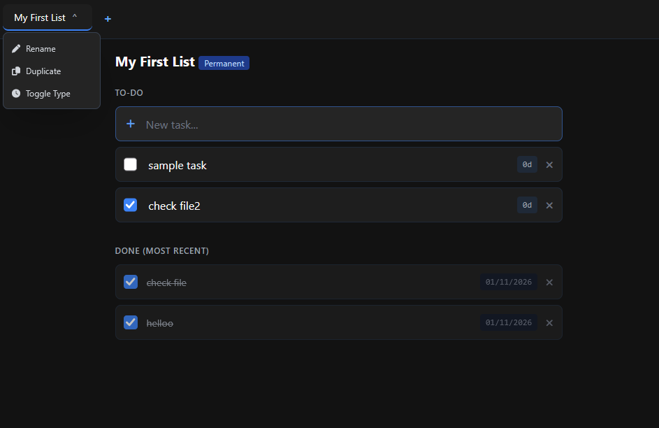
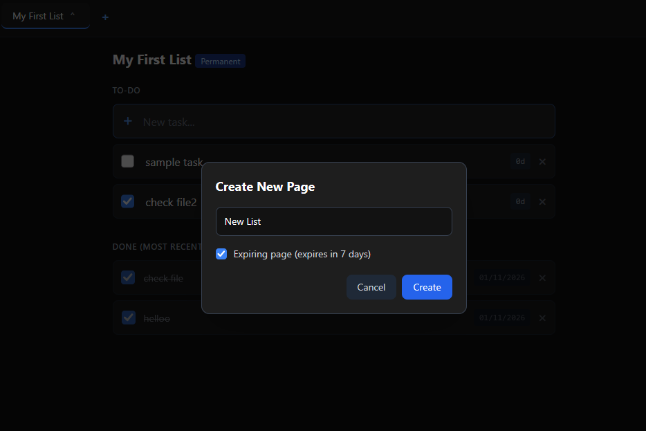
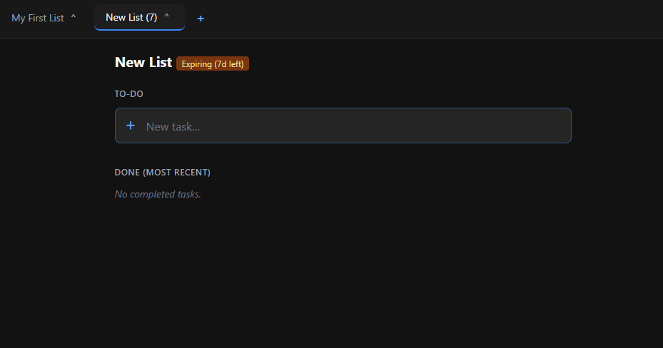

# 📝 VibeNotes

**VibeNotes** is a **vibe-coded** (i was bored), sleek, mobile-optimized, dark-mode To-Do list web application built with **Python (Flask)**. Inspired by OneNote and Google Keep, it allows you to organize tasks across custom pages, handle temporary/expiring shopping lists, track task aging, and automatically sync all your changes straight to GitHub.

---

## ✨ Key Features

* **🗂️ OneNote-Style Tabs:** Switch effortlessly between multiple note pages. Each tab features a custom dropdown menu (`^`) to **Rename**, **Duplicate**, **Toggle Type**, or **Delete** pages.
* **⏱️ Permanent & Expiring Pages:** 
  * *Permanent pages* stay forever.
  * *Expiring pages* feature a countdown timer right in the tab name (e.g., `Groceries (7)` $\rightarrow$ `Groceries (6)`), making them ideal for grocery and temporary lists.
* **⚡ Google Keep-Style Quick Add:** No extra buttons required—just type your task into the permanent top row of the To-Do list and click away (or press Enter) to instantly register it.
* **📊 Task Lifecycle & Aging:**
  * Active tasks track how many days they have remained in the to-do list (e.g., `3d`).
  * Checking off a task moves it to the **"Done"** section, records the exact completion date (e.g., `30/10/2026`), and sorts them by most recent.
  * Completed items are automatically cleaned up after 30 days.
  * Moving a task back to the To-Do list resets its aging timer.
* **🌙 Slick Dark Mode UI:** Designed with a modern, distraction-free dark interface optimized for both Windows desktops and Android mobile browsers.
* **🔄 Automatic GitHub Syncing:** Every user interaction (adding notes, checking tasks, modifying settings) updates a local JSON data store and automatically commits & pushes the changes back to your GitHub repository in real time.

---

## Tech Stack

* **Backend:** Python, Flask, Git Python Automation
* **Frontend:** HTML5, Tailwind CSS, JavaScript (Fetch API)
* **Storage:** JSON-backed flat file database (`vibenotes_data.json`) for seamless Git version control tracking.

## Hosting on PythonAnywhere

This app is configured to run natively on PythonAnywhere and automatically push state updates back to GitHub